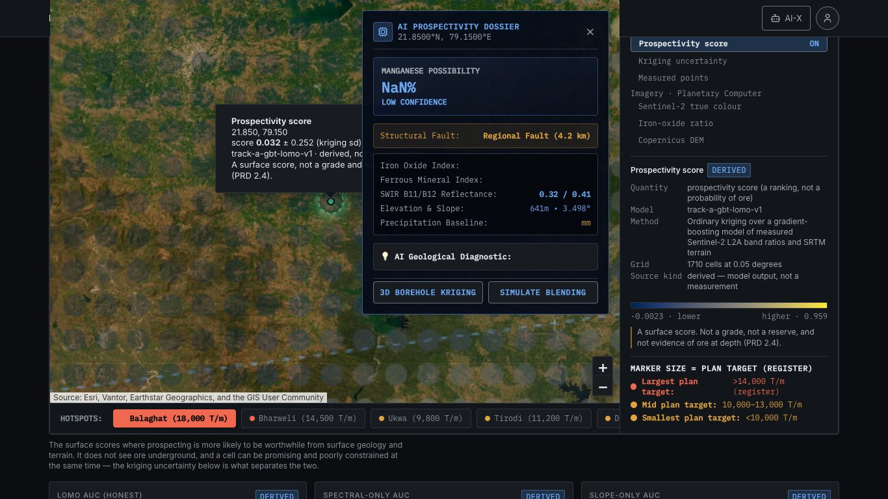
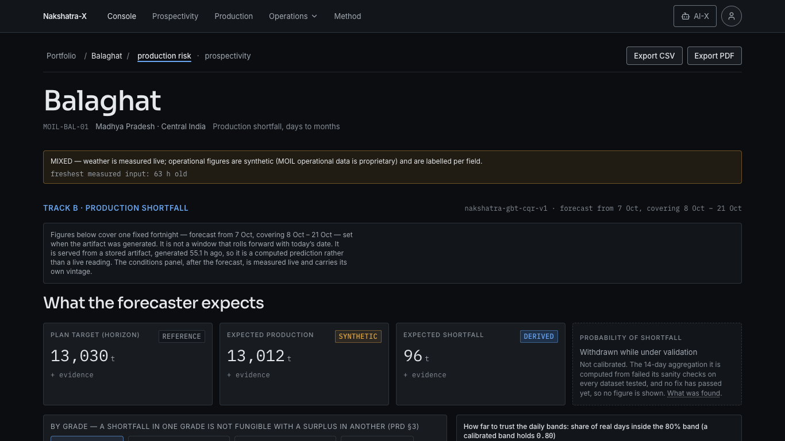
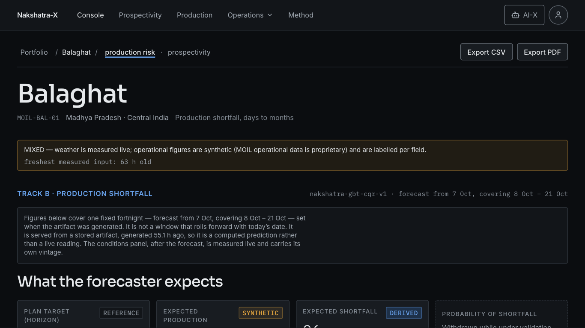
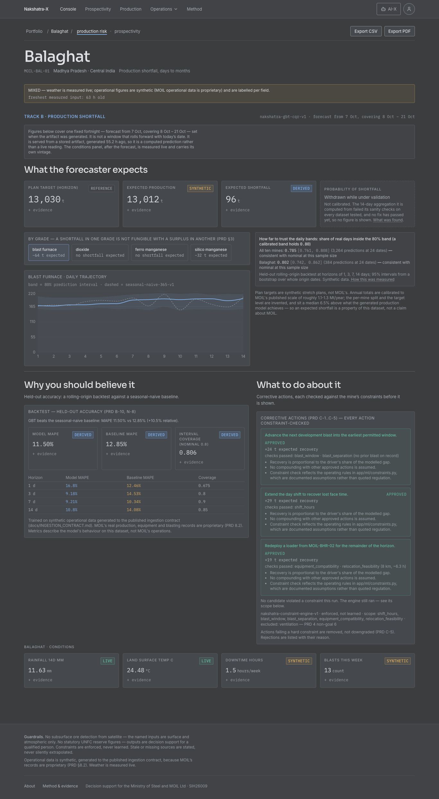
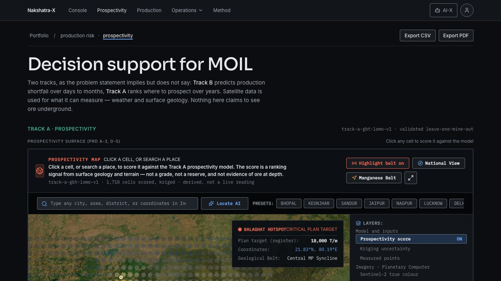
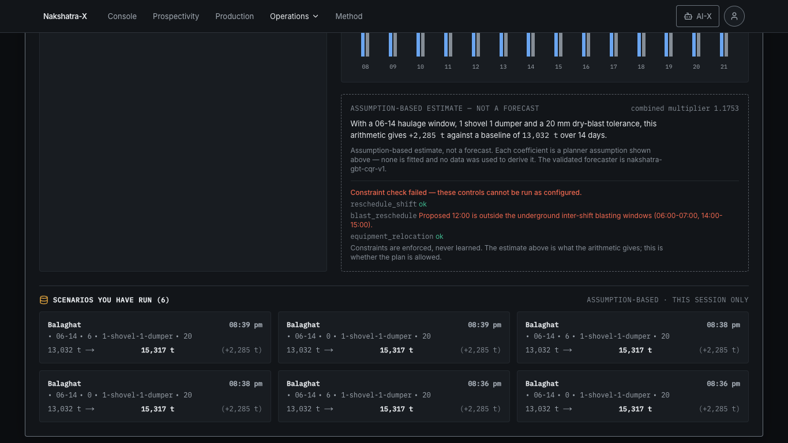
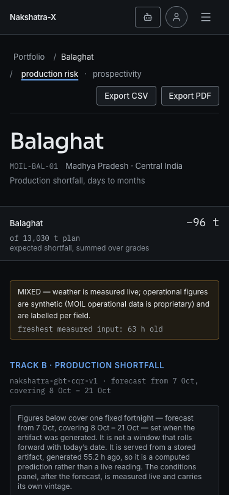
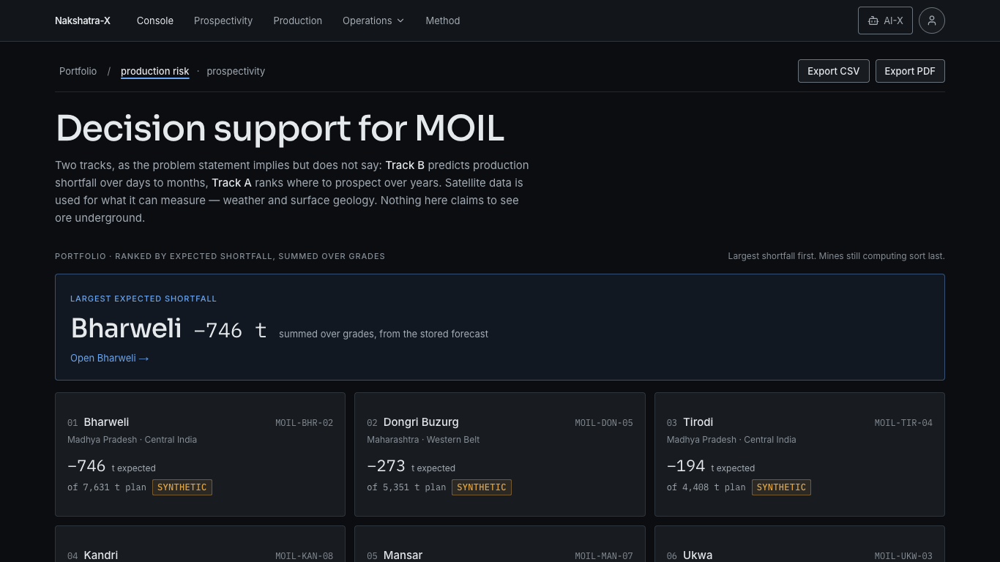
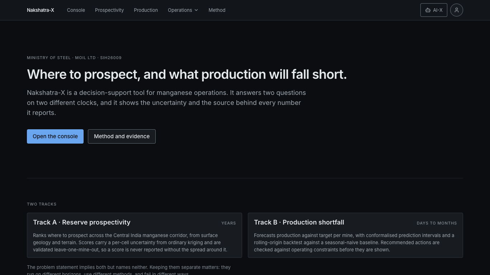

# Pitch polish — audit of the demo path

**Build audited:** `v1.0-pitch` (`6829ca5`), dataset frozen 2026-10-07, served as
`/readyz` reports it. **Captured:** 2026-10-11, live upstreams, production build
(`npm run build && npm start`), fonts loaded (Inter, IBM Plex Mono — recorded
by the capture). **Scope:** only the three-minute path in `docs/DEMO.md` —
landing, console portfolio, Balaghat, Mine twin's constraint beat, Track A and
each map layer, and what a click on the map opens.

How it was captured, so it can be repeated after the fixes:

```bash
cd frontend
node tools/polish-capture.js --out ../docs/design/polish/before
node tools/polish-capture.js --out ../docs/design/polish/before-washout --only 1366,1366z125 --washout
```

| Viewport id | Screen | CSS layout | Why |
|---|---|---|---|
| `1280` | 1280×800 at 100% | 1280×800 | the design system's desktop width |
| `1366` | 1366×768 at 100% | 1366×768 | the commonest projector / laptop-output mode |
| `1366z125` | 1366×768 at 125% zoom | 1093×614 | what a presenter does to be read from the back |
| `1920` | 1920×1080 at 100% | 1920×1080 | a full-HD projector |
| `1920z125` | 1920×1080 at 125% zoom | 1536×864 | same, zoomed |
| `375` | phone | 375×812 | the design system's mobile width |

Zoom is emulated the way the browser applies it: the page lays out in fewer CSS
pixels, each drawn 1.25 device pixels wide. A windowed browser loses another
~100 px of height to its tabs and address bar; the fold figures below assume
presentation mode (full screen), which is how the demo should be run.

`polish/before/_capture.json` records where each element the presenter points
at sits, per viewport. Shots are `before/<viewport>-<screen>.png`, plus `-full`
for the whole page; imagery-heavy shots are JPEG.

**My specific complaints (user):** none were filled in, so this audit stands on
its own reading.

---

## Projector legibility — the minimums adopted

**Geometry assumed.** 1366×768 projected on a 100-inch 16:9 screen (2.21 m
wide), farthest judge at 4 m. One CSS pixel is then 1.6 mm on the screen at
100% zoom, and 2.0 mm at 125%.

**Size.** Legibility is set by the angle a lowercase letter subtends. About
10 arcmin of x-height is the floor for reading words; about 16 arcmin is
comfortable. At 4 m those are 11.6 mm and 18.6 mm. Inter's x-height is about
0.55 em, so at 100% zoom:

| Use | Minimum adopted | Why |
|---|---|---|
| Anything the presenter points at: labels, chart ticks, legends, annotations | **13 px** (12 px uppercase labels) | 13 px → 7.2 px x-height → 11.5 mm ≈ 10 arcmin. Uppercase reads by cap height (0.73 em), so a 12 px label clears it too. |
| Headings | **22 px** | ≈ 16 arcmin, comfortable. |
| The focal answer on each screen | **≥ 36 px** | It should be read before anything else, from the back. |
| Footnotes not read from the stage | 12 px (design-system floor) | Unchanged. |

At 125% zoom every one of these gains 25%, which is why the presenter should
zoom.

**Contrast.** Key text — the focal answer, its label, chart ticks and legend,
the verdicts — at **≥ 7:1** on the surface it sits on. In the token set that
means `text-primary` anywhere, or `text-secondary` on surfaces 0–2 only
(7.28–8.28:1). `text-tertiary` (4.65–5.79:1) is for footnotes.

**Washed-out projector.** Simulated as `filter: contrast(0.65)
brightness(1.15)` over the whole page: black lifts to about 20%, contrast drops
to 65%. Shots are in `polish/before-washout/`. What the filter does to the
token pairs (WCAG ratio, normal → washed):

| Foreground | on surface-0 | on surface-1 | on surface-2 | on surface-3 |
|---|---|---|---|---|
| text-primary | 15.97 → 8.33 | 15.02 → 7.61 | 14.04 → 7.02 | 12.82 → 6.39 |
| text-secondary | 8.28 → 5.11 | 7.79 → 4.66 | 7.28 → 4.30 | 6.65 → 3.92 |
| text-tertiary | 5.79 → 3.96 | 5.45 → 3.62 | 5.09 → 3.34 | 4.65 → 3.04 |
| accent | 7.65 → 4.77 | 7.20 → 4.36 | 6.73 → 4.02 | 6.14 → 3.66 |
| border-default | 1.55 → 1.57 | 1.46 → 1.43 | 1.36 → 1.32 | 1.24 → 1.20 |

Surface steps differ by 1.06–1.10:1 either way. So:
- **Only `text-primary` survives a washed-out projector at ≥ 7:1.** Key text
  has to be primary.
- **Anything carried by a near-black value difference is invisible** — a
  card's fill against the page, a 16% band fill, a decorative border. It may
  group things; it may not carry information.

---

## Issues, ranked by demo impact

Ranked by what a judge sees, in the order the three-minute path shows it, and
by how badly it hurts there. "Fold" is the bottom of the screen without
scrolling.

### 1. A click on the map opens a panel of invented and broken numbers — Track A, 2:30



**What a judge sees.** The map says *"Click any cell to score it against the
model"*. Clicking opens an "AI PROSPECTIVITY DOSSIER" over the map:
**"Manganese possibility NaN%"**, "Structural fault: Regional Fault (4.2 km)",
"SWIR B11/B12 reflectance 0.32 / 0.41", four empty rows, an empty "AI
Geological Diagnostic", and two buttons ("3D Borehole Kriging", "Simulate
Blending") that link to an anchor that does not exist on the page. It also
covers the honest popup that the same click opens at the cell (score ± kriging
sd, "derived, not a live reading").

**Root cause** (`IndiaSatelliteMap.tsx`, `triggerAIPrediction` and the
dossier JSX). The panel was written for an older response shape —
`probability`, `features.iron_oxide_index`, `nearest_fault_name`,
`geological_interpretation` — and the real `/prospectivity/predict` sends none
of them. So `probability * 100` is NaN, and literal fallbacks fill the rest:
`|| 4.2` km, `|| 0.32` and `|| 0.41`. When the request fails,
`createFallbackPrediction` builds a whole prediction locally — a probability
from a lat/lng box, features from a sine-hash seed, `model_accuracy_pct: 100`,
and `is_live_api: true` — and the panel shows it as a model result. That is
exactly what PRD N-6 and the zero-fabrication rule forbid, and the Next route
was rewritten to return 503 precisely so this could not happen; the component
re-creates it on the client.

**Why no guard caught it.** The rendered-page provenance guard and
`lint:literals` read the page as it loads. The panel exists only after a click
on a Leaflet path.

**Fix.** Render the response the API actually returns, through `Metric`: the
kriged score with its kriging sd, the direct model score (or the API's reason
it has none), the scene and the guardrails. On failure, say the model is
unavailable, with its reason, and show no number. Delete
`createFallbackPrediction` and the dead buttons. The loading line stops
claiming "Running AI Manganese Machine Learning Engine". A browser check
clicks a cell and asserts no NaN and no number without provenance.

### 2. Balaghat: the focal answer does not read first — 1:05




**What a judge sees.** Between the mine's name and the answer: a 58 px
integrity banner, an accent-blue "TRACK B · PRODUCTION SHORTFALL" kicker with
the model and window in mono, a 105 px box of prose about the fortnight, and an
H2. Then four tiles of identical weight. The largest numbers on the screen are
**13,030** (plan) and **13,012** (expected production), five digits at 24 px;
the answer, **96 t**, is two digits in the third tile at the same size and
reads as the smallest. The fourth tile, where P(shortfall) was, is a dashed box
of 11–12 px text that looks like a tile that failed to load.

At 1366×768 at 125% the answer's tile starts at y = 562 of a 614 px screen:
its number is below the fold.

**Root cause.** `TrackBPanel` gives every `Metric` `emphasis` (same size), in
a four-column grid; the window disclosure is a paragraph rather than an
annotation; the withdrawn tile was dropped into the hole P left (D-044) with
the same footprint as a figure.

**Fix.** One focal tile — expected shortfall at display size, spanning half the
row — with plan and expected production as the supporting pair beside it, and
the withdrawal as a quiet annotation under the focal number ("probability of
shortfall: withdrawn while under validation · what was found"), so the space
reads as a statement, not a gap. The fortnight disclosure becomes one line
(the dates, "stored forecast, not a live reading", its age) — same facts, same
test hooks. The kicker drops its accent colour.

### 3. The trajectory chart is below the fold, and washes out — 1:05



**What a judge sees.** At 1280×800 and 1366×768 the chart starts at y = 901
(993 at 125%): the presenter has to scroll mid-sentence. Once there, the band
and the median occupy the top fifth of the plot, because the y axis runs from
0 t to 220 t for values between about 150 and 210. Below the band sits a slab
of a slightly different near-black — the `p10` area painted in `surface-2` to
mask the band's lower half. The seasonal-naive baseline is a 1 px grey dash
(DEMO.md calls it "the dashed amber line"; it is grey). Ticks are 12 px
tertiary: 5.09:1, and 3.34:1 washed out. In the washout shot the band is not
distinguishable from the slab under it.

**Root cause.** Recharts' default domain from zero; the band drawn as two
stacked areas with a background-coloured mask, so the band exists only as a
16% accent tint against near-black; the stacking above it (issue 2) pushes the
chart down.

**Fix.** Draw the band as one ranged area between p10 and p90 (no mask), with
its edges stroked so the interval is carried by lines, not by a tint; a
y domain fitted to the data with headroom; 13 px secondary ticks; the
baseline at 1.5 px in `text-secondary` with a direct label; the median at
2.5 px. Pull the grade chips into the chart card's header (they are its
selector), and with issue 2's space this puts the chart's top above the fold
at 1280×800 and 1366×768. DEMO.md's "amber" corrected.

### 4. Key text at projector distance — every console screen

**What a judge sees.** Metric labels ("EXPECTED SHORTFALL") are 11 px tertiary
(5.09:1; 3.34:1 washed). Card meta, chart ticks, the calibration lines' CIs
and the backtest table header are tertiary. Three different eyebrow styles
carry the same role: `.label` (11 px tertiary), `text-xs uppercase
tracking-wider` (12 px secondary) and `text-sm semibold uppercase` in accent
blue (Track B) or nominal green (Track A).

**Status colour used as decoration**, against the design system's §3.4:
Track A's heading is `status-nominal` green; the backtest table prints model
MAPE in accent and baseline MAPE in `status-caution` amber; the map's hotspot
card says "CRITICAL PLAN TARGET" in red for the largest plan, which is not a
breached threshold.

**Fix.** `.label` → 12 px `text-secondary`; one eyebrow style everywhere on the
path; chart text 13 px secondary; the figures a presenter reads in
`text-primary`; status hues only for states. No token changes — every change
is in which token a role uses, and each moves contrast up.

### 5. Track A: the map starts below the fold, under a legacy toolbar — 2:30



**What a judge sees.** On `/console?track=a` the portfolio's hero ("Decision
support for MOIL" and its paragraph) repeats above Track A, then a green
kicker, then the map's own toolbar: a red "PROSPECTIVITY MAP" title, a red
"Highlight belt on" toggle, "Locate AI", and a preset strip that jumps to
Bhopal, Jaipur, Lucknow, Delhi and Mumbai. The map's top edge is at y = 586
(618 at 125%), so on a 768 px screen the room sees 180 px of map. The selected
mine's card sits over the map's top-right corner; on a phone it covers the top
of the map (known open item).

**Root cause.** The map component predates the design system and kept its own
vocabulary (bold uppercase mono, red, rounded-full chips); the console's
portfolio hero renders for Track A as well.

**Fix.** On Track A, the hero shrinks to the one-line track heading; the
toolbar's title and toggles move to tokens (neutral, sentence case, no red);
the hotspot card loses "CRITICAL" and its status red; on phones the card moves
off the map into the dock under it. The presets stay (removing them would be a
feature change) but read as quiet chips.

### 6. Mine twin: the verdict is the smallest text in its panel — 2:20



**What a judge sees.** The beat is "the engine rejects it by name". The
verdict, *"Constraint check failed — these controls cannot be run as
configured"*, is 13 px red text at the bottom of a dashed box. Beside it, the
left column is a 400 px empty panel. Above, the page has two titles
("Scenario calculator", then "Mine twin", then "Balaghat") and 112 px of empty
top padding before the first one.

**Root cause.** The verdict is styled as a line in the estimate's footnote;
the controls column stretches to the row's height; the page wrapper keeps the
old landing page's top padding.

**Fix.** The verdict becomes the panel's focal line — 22 px, with the status
shape and the word "failed"/"passed", the violated rule under it at 15 px;
the controls column stops stretching; the top padding matches the console's;
"Mine twin" stays as the one H1 the panel needs.

### 7. Motion on the console that runs forever — Track A

A map click drops a crosshair whose ring spins on a 6 s infinite loop with a
22 px glow; the dossier slides in over 300 ms. Both break the console rule
(≤ 300 ms, functional only) and the design system's ban on perpetual motion and
glows. **Fix:** a static marker; no slide.

### 8. Phone layout — Balaghat and Track A




At 375 the sticky summary does put the answer (−96 t) in the fold, which works.
But **once you scroll, it hides the section tabs**: the summary is sticky at
56 px and about 90 px tall, and the tab bar is sticky at 104 px, so the tabs
slide under it. The shot above is the Drivers tab after tapping it — no tab bar
on screen. Around it: the breadcrumb wraps so "/ production risk" starts a line
on its own; Export CSV / PDF take a full row; the fortnight paragraph is 140 px.
The Track A card covers the map (issue 5).

**Fix:** the summary becomes one line (48 px), which is what the tab bar's
104 px offset assumes; the one-line disclosure from issue 2 removes the
paragraph; the hotspot card moves off the map on phones.

### 9. Portfolio — works; small things



The focal band answers "which mine" in one line at every width (y = 374–520,
inside the fold even at 125%). Minor: in the band the mine's name is the
largest element and the shortfall, the actual answer, is a lighter mono 24 px;
the ranking cards' plan line is mono 12 px secondary. **Fix:** the shortfall
in the band matches the name's size; nothing else.

### 10. Landing — calm, legible, unchanged



One H1, one lead paragraph, two actions. It already follows the principles
and keeps its narrative. No change.

### 11. Loading, warming and empty states

Present and honest everywhere on the path (skeletons of the right size, a
blue "Computing — about N s" for a warming backend, explicit "unavailable"
with a reason). Two inconsistencies: Track A's spinner is status-green, and
spinners are used where the design system specifies a skeleton. **Minor — left
as is** unless the fixes above touch the same lines.

---

## What is out of scope, and goes to the backlog

- The map's search box, presets and "national view" — a separate tool inside
  the map; restyled where issue 5 needs it, not restructured.
- The marker colours on the map (status red/amber by plan-target size). They
  are drawn inside Leaflet icon HTML; recolouring them is a map-styling change
  across every layer. Logged in `docs/design/FEATURE_BACKLOG.md`.
- Mine twin's scenario history (six identical cards after a rehearsal). It is
  session state, not layout.

---

## Result — after the fixes (2026-10-11)

Same capture, same build process: `polish/after/`, `polish/after-washout/`,
`polish/after/_capture.json`. Taken on `ecfc090`, with the map-click shots
re-taken on `8176055` (the panel's width). The two code commits after that,
`633fd7d` and `0f0c2a8`, change what the console draws while it loads and
add comments; no settled screen differs.

Lighthouse 13.5.0 on the final build (live upstreams, quiet machine, memory
pressure normal), median of three runs:

| Page | Form factor | Performance | Accessibility | CLS | LCP |
|---|---|---|---|---|---|
| `/` | desktop | 98 | 100 | 0.000 | 1.06 s |
| `/console` | desktop | 100 | 100 | 0.000 | 0.82 s |
| `/` | mobile (Lighthouse default throttling) | 90 | 100 | 0.000 | 3.68 s |
| `/console` | mobile (Lighthouse default throttling) | 91 | 100 | 0.000 | 3.47 s |

| Issue | Fixed in | What changed |
|---|---|---|
| 1. Map click: NaN% and invented fields | `dd9b4ce`, `8176055` | The click renders the model's response through `Metric` (`PointScore`, shared with "Score a location"); a failed request says so with no number; the browser-side fallback prediction is deleted; the marker is static. `test:e2e` clicks a cell and checks it. |
| 2. Balaghat focal hierarchy | `a8028d4` | Expected shortfall is the one focal tile (48/64 px); P(shortfall)'s withdrawal is an annotation under it; plan and expected production frame it, with why the shortfall is not their difference. |
| 3. Chart below the fold, washes out | `2a1af5a`, `71e3c45` | Chart beside the answer; ranged band with drawn edges; axis fitted to the data; 13 px secondary ticks with dates; a key with the marks. |
| 4. Key text on a projector | `c2b9b60` | `.label` 12 px secondary, one eyebrow style; no status colour as decoration on the path. |
| 5. Track A below the fold | `473754a` | Own heading; one-line map header; neutral controls; the no-op "Highlight belt" toggle removed; the mine card off the map on phones. |
| 6. Mine twin's verdict | `1d148e4` | 22 px verdict with its status shape; controls sticky beside it; one title; the "AI forecast" chart title corrected. |
| 7. Perpetual motion | `dd9b4ce` | The spinning, glowing crosshair and the slide-in are gone. |
| 8. Phone | `71e3c45` | The sticky summary is 48 px and no longer hides the section tabs; the chart's dates fit. |
| 9. Portfolio band | `cf3b3b1`, `ecfc090` | The shortfall at the name's size, without growing the band past its reserved height. |
| Found while measuring: the portfolio shifted when its ranking landed | `633fd7d` | The mine list is keyed by slot, not by mine, so React no longer moves card nodes from register order to rank order; the register-loading state reserves the loaded layout. `/console` CLS 0.063 → 0 at 1280×800; Lighthouse desktop 0.101 → 0.000. Pre-existing on main. |

**Where the presenter's elements sit now** (CSS px from the top; fold = screen
height in CSS px):

| Viewport | Fold | Focal tile top | Chart top | Track A map top | Mine-twin verdict top |
|---|---|---|---|---|---|
| 1280×800 | 800 | 562 → **440** | 901 → **666** | 586 → **504** | 2049 → 1921 |
| 1366×768 | 768 | 562 → **440** | 901 → **666** | 586 → **504** | 2049 → 1921 |
| 1366×768 at 125% | 614 | 562 → **460** | 993 → 750 | 618 → **504** | 2065 → 1937 |
| 1920×1080 | 1080 | 562 → **440** | 901 → **666** | 586 → **504** | 2049 → 1921 |
| 1920×1080 at 125% | 864 | 562 → **440** | 901 → **666** | 586 → **504** | 2049 → 1921 |
| 375 (phone) | 812 | 1238 → **792** | in the Drivers tab | 1054 → **798** | 3387 → 3273 |

- **At 1280×800 and 1366×768 the chart now starts on the first screen**
  (known open item 1). At 1366×768 at 125% it still starts 136 px below the
  fold; the focal answer does not.
- **On a phone the mine card no longer covers the map** (known open item 2);
  it is not drawn below `sm`, and the dock under the map names the mine.
- **Mine twin's verdict is still below the fold**, by the page's nature; the
  presenter scrolls to the controls, and the controls now stay beside the
  verdict.
- **Washed out**, the Balaghat answer, its labels and the chart's band edges
  stay legible (`after-washout/1366-03-balaghat*.png`): key text is
  `text-primary`, 7.0:1 or better through the filter on surfaces 0–2, where
  all of it sits.

## What is left, and why it is left

Minor, by the rule this pass stopped on:

- The app has no favicon (`/favicon.ico` 404 in the console on every route,
  before and after). The browser shows its default tab icon.
- The map's search presets jump to cities outside the manganese belt (Delhi,
  Mumbai, Lucknow). They are restyled only where issue 5 needed it; removing
  or replacing them would change the tool, not its look.
- On a phone, the map's zoom buttons overlap the bottom of an open point-score
  panel; the panel scrolls.
- Spinners where the design system says skeletons (backlogged).
